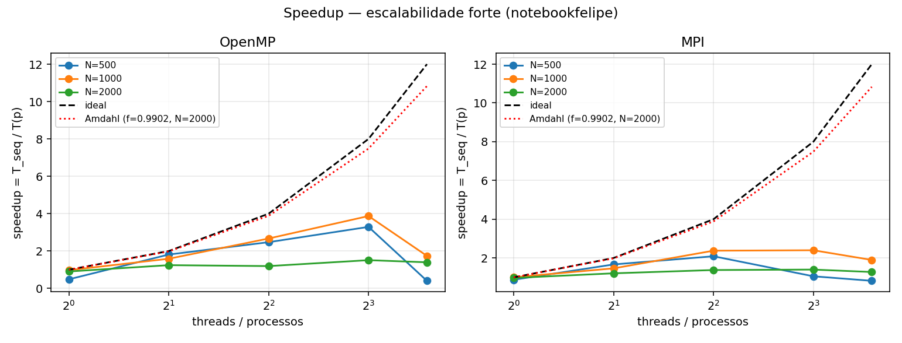
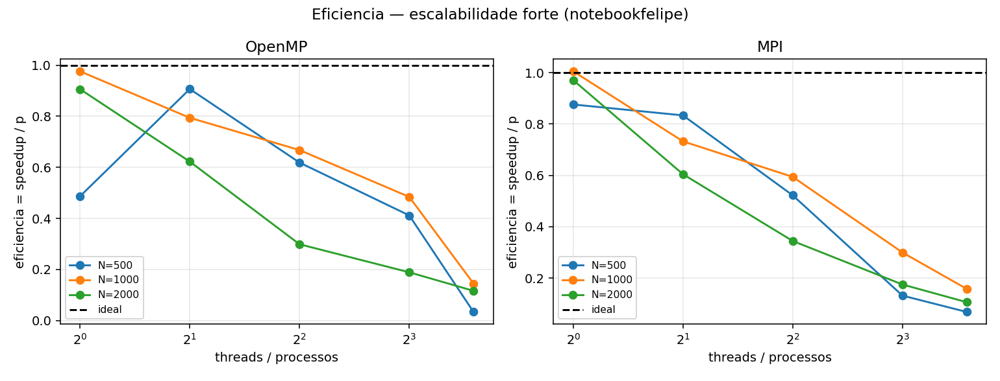
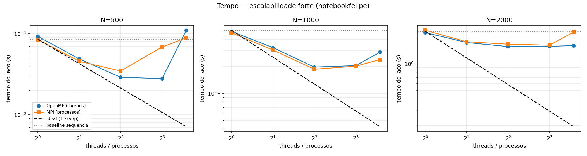
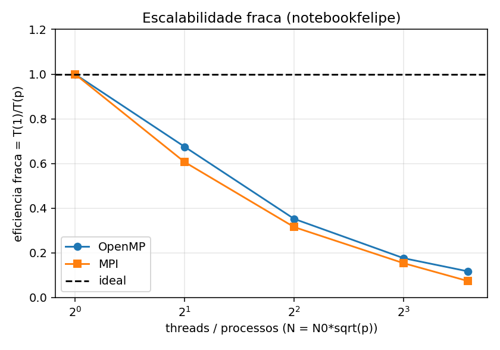
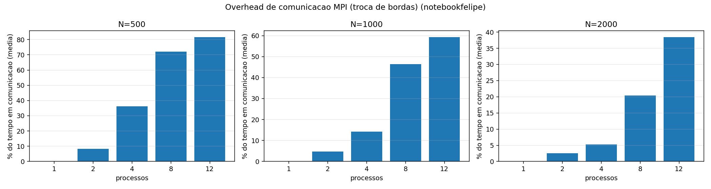
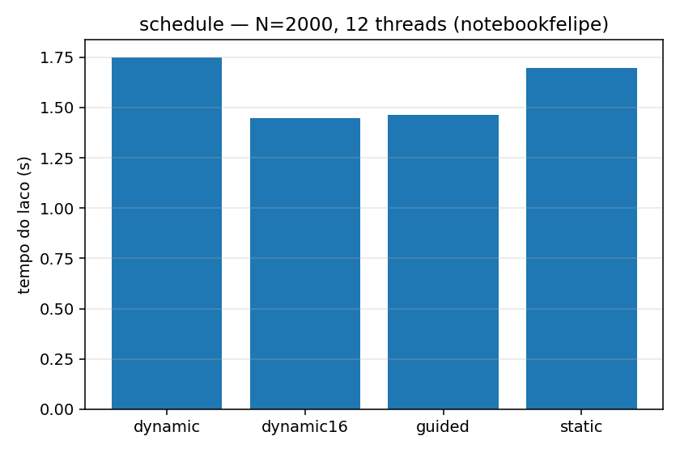
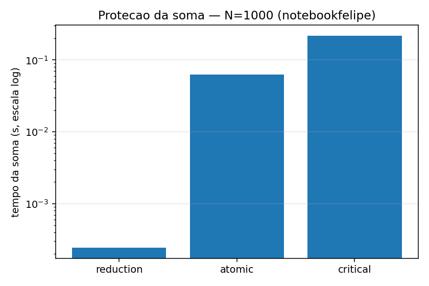

# Análise experimental — Equação do calor 2D (OpenMP e MPI)

Programação Paralela (CCO085) — IESB 2026/2. Problema 5: stencil de Jacobi de 5 pontos, `N×N`, `T = 500` passos. (Discretização do laplaciano de 5 pontos; com r = 1/4 o coeficiente do ponto central se anula e o código lê só os 4 vizinhos.)
Dados em `dados/`, figuras em `graficos/`. Todos os tempos são do **laço de passos** (como no baseline do professor).

## 1. Ambiente e metodologia

| Item | Valor |
|---|---|
| Máquina | notebook, Intel Core i5-13420H: 8 núcleos (4 de desempenho com 2 threads cada + 4 de eficiência) = 12 threads lógicas; 12 MB de cache L3 (especificação do fabricante) |
| RAM / SO | 32GB DDR5 / WINDOWS 11 (usando docker) |
| Software | contêiner Docker (Ubuntu 24.04), `g++ -O2 -std=c++17`, OpenMPI da imagem (ver `Dockerfile`) |
| Protocolo | 1 execução de aquecimento descartada + 10 repetições por configuração; os gráficos usam a **mediana** |
| Tamanhos | N = 500, 1000, 2000 (escala forte); N = 1000·√p (escala fraca) |
| Speedup | `S(p) = T_seq / T(p)`, com `T_seq` do baseline do professor; eficiência `E(p) = S(p)/p` |

## 2. Perfilamento e Lei de Amdahl

O hotspot é o laço duplo do stencil, dentro do laço de tempo (complexidade O(N²·T)). Inicialização e checksum são O(N²).

| N | init (s) | laço (s) | soma (s) | fração paralelizável f | limite de Amdahl (p→∞) |
|---|---|---|---|---|---|
| 500 | 0,0017 | 0,0626 | 0,0001 | 97,2% | 35× |
| 1000 | 0,0091 | 0,4967 | 0,0007 | 98,1% | 52× |
| 2000 | 0,0391 | 2,2541 | 0,0030 | 98,2% | 55× |

Previsão de Amdahl para N=1000 (f = 0,981): 3,8× com 4 processadores e 7,0× com 8. Para N=2000: 3,8× e 7,1×.

## 3. Escalabilidade forte

Speedup medido (mediana):

| N | versão | p=2 | p=4 | p=8 | p=12 |
|---|---|---|---|---|---|
| 500 | OpenMP | 1,75 | 2,95 | 3,06 | 0,77 |
| 500 | MPI | 1,87 | 2,47 | 1,25 | 0,96 |
| 1000 | OpenMP | 1,56 | 2,58 | 2,49 | 1,76 |
| 1000 | MPI | 1,66 | 2,73 | 2,52 | 2,13 |
| 2000 | OpenMP | 1,34 | 1,49 | 1,48 | 1,45 |
| 2000 | MPI | 1,31 | 1,40 | 1,44 | 1,02 |

**O ganho real fica muito abaixo do previsto por Amdahl** (por exemplo, 2,6× contra 3,8× com 4 threads em N=1000, e 1,5× contra 7× com 8 threads em N=2000). A fração serial (≈2%) explica pouco dessa diferença. As causas observadas:

1. **Limite de banda de memória (causa principal).** O stencil faz 4 operações de ponto flutuante por atualização (3 somas e 1 multiplicação) e move dezenas de bytes. Com N=500 os dois buffers ocupam 4 MB e cabem no cache L3 (12 MB); com N=1000 ocupam 16 MB e ficam no limite do L3; com N=2000 ocupam 64 MB e o laço é servido pela RAM. O speedup cai exatamente nessa ordem (≈3,0×, ≈2,5–2,7×, ≈1,4–1,5×). Estimativa: com ~24 bytes por atualização (leitura, escrita com alocação de linha e write-back), o baseline de N=2000 move ~48 GB em 2,33 s, ou seja ~21 GB/s com **uma** thread, e o OpenMP com 4 a 8 threads chega a ~31 GB/s e para de melhorar. A memória, não o processador, é o recurso compartilhado que satura. *(24 B/atualização é estimativa; para confirmar, medir a banda com um benchmark do tipo STREAM.)*
2. **Queda com 12 threads.** O processador é híbrido: as 8 threads dos 4 núcleos de desempenho (com SMT) são mais rápidas que as 4 dos núcleos de eficiência. Com `schedule(static)`, cada thread recebe a mesma quantidade de linhas e há uma barreira a cada passo, então o passo dura o tempo da thread mais lenta. Hipótese consistente com a seção 6 (escalonamento dinâmico melhora com 12 threads), mas não testada diretamente (por exemplo, fixando as threads em tipos de núcleo).
3. **Overhead de comunicação (MPI).** Ver seção 5.
4. **Sincronização por passo.** Com N=500 cada passo dura ~0,1 ms, e o custo da barreira (OpenMP) ou da troca de bordas (MPI) deixa de ser desprezível. Por isso N=500 satura já em p=4.
5. **False sharing:** não é relevante aqui, porque as threads escrevem em linhas distintas (`nxt[y*N+x]`) e só as bordas de cada bloco ficam em linhas de cache vizinhas.

## 4. Escalabilidade fraca

Com N² / p constante, a eficiência `E = T(1)/T(p)` foi:

| p | 2 | 4 | 8 | 12 |
|---|---|---|---|---|
| OpenMP | 0,68 | 0,35 | 0,18 | 0,12 |
| MPI | 0,61 | 0,32 | 0,15 | 0,07 |

O tempo cresce quase linearmente com p. Isso é o comportamento esperado de um programa limitado por banda: a quantidade total de dados cresce com p, mas a banda da memória é fixa. Ressalva: o caso p=1 (N=1000) usa dados que quase cabem no cache, enquanto os maiores não, então parte da queda é efeito de cache.

## 5. Overhead de comunicação (MPI)

Fração do tempo gasta na troca de bordas (média entre processos):

| N | p=2 | p=4 | p=8 | p=12 |
|---|---|---|---|---|
| 500 | 10,5% | 26,0% | 67,0% | 81,4% |
| 1000 | 6,0% | 14,5% | 42,1% | 56,4% |
| 2000 | 3,8% | 6,1% | 23,3% | 56,5% |

Por passo e por processo, a comunicação é de 2N doubles (constante em p), enquanto o cálculo diminui com 1/p. Logo a fração de comunicação cresce com p e é maior para N pequeno. Esse tempo inclui **espera pelo vizinho mais lento**, não só a cópia: com 12 processos o ritmo é ditado pelo processo mais lento. A decomposição 2D reduziria o volume de comunicação por processo (de 2N para ~4N/√p), mas exigiria tipos derivados do MPI para as colunas.

## 6. Escalonamento (OpenMP, N=2000, 12 threads)

| schedule | mediana (s) |
|---|---|
| static | 1,70 |
| dynamic (chunk 1) | 1,75 |
| dynamic,16 | 1,45 |
| guided | 1,46 |

A carga por linha é uniforme, então não há desbalanceamento de **trabalho**. Mesmo assim, `dynamic,16` e `guided` ficaram ~15% abaixo de `static`, o que é compatível com o desbalanceamento de **velocidade** entre os tipos de núcleo (seção 3). `dynamic` com chunk de 1 linha não ganha, porque paga o custo de distribuir cada linha. As faixas de mínimo e máximo se sobrepõem parcialmente, então a diferença é indicativa, não conclusiva. Para N e p menores, `static` é a escolha natural.

## 7. Condição de corrida e proteção da soma

O stencil **não tem corrida**: lê `cur` e escreve só `nxt` (dois buffers), cada thread escreve linhas distintas, e a barreira ao fim do `omp for` separa os passos. A corrida possível está na soma do checksum (todas as threads escrevem em `soma`). Tempo da soma com N=1000 e 12 threads (mediana):

| Proteção | Tempo (s) | Relativo |
|---|---|---|
| `reduction(+:soma)` | 0,00024 | 1× |
| `atomic` | 0,063 | ~260× |
| `critical` | 0,216 | ~900× |

Escolha: **`reduction`**. Cada thread acumula uma soma parcial privada e só combina no fim; `atomic` e `critical` serializam as 10⁶ somas. A variante sem proteção (`calor2d_omp_race`) existe para demonstrar a corrida.

## 8. Validação de corretude

Todas as versões imprimem um hash (FNV-1a de 64 bits) da grade final. O script `scripts/validar.sh` compara OpenMP (1 a 8 threads, três escalonamentos, `atomic` e `critical`) e MPI (1 a 7 processos, incluindo N não divisível por p e um caso em que o calor chega à borda) com o baseline instrumentado: **144 comparações, todas idênticas bit a bit**. Nas medições, as 470 execuções de OpenMP e MPI produziram um único hash por (N, T). O checksum sozinho é um validador fraco, porque o stencil conserva a massa.

## 9. Limitações

- **Deriva do sistema entre medições.** O baseline medido durante a coleta (N=500: 0,086 s) ficou mais lento que o do perfilamento feito minutos antes (0,063 s). Notebooks mudam de frequência com temperatura e energia, e isso desloca todos os speedups. Os valores absolutos devem ser lidos como indicativos; as conclusões qualitativas (limite de banda, saturação em 4–8, queda em 12) se repetiram em duas rodadas.
- **Ambiente virtualizado.** As medições rodaram em Docker (WSL2), que pode ocultar parte da topologia híbrida de núcleos.
- **Ruído com 12 threads.** É onde a variação entre repetições é maior (por exemplo, OpenMP N=500: 0,08 a 0,34 s).
- As medições no computador do laboratório estão em `dados/` com o rótulo `faculdade` *(preencher se feitas)*.
