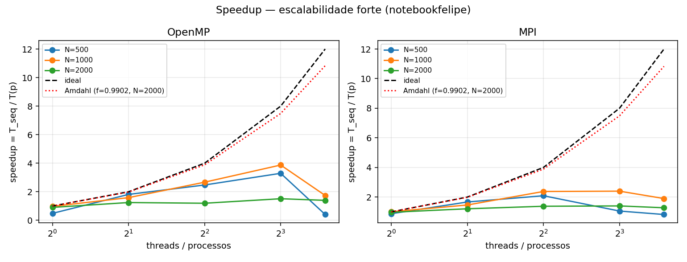
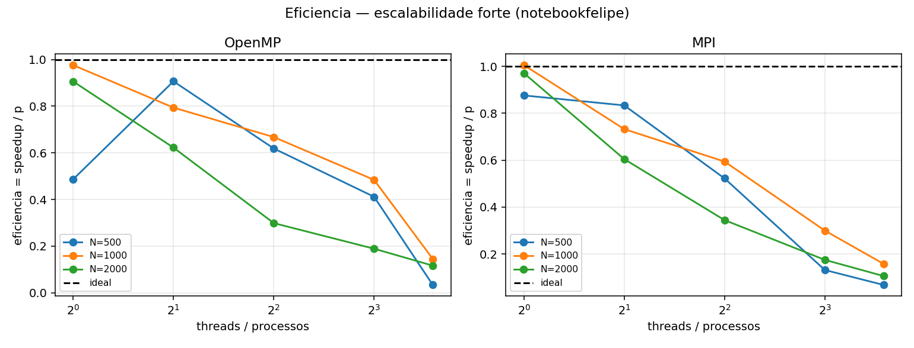
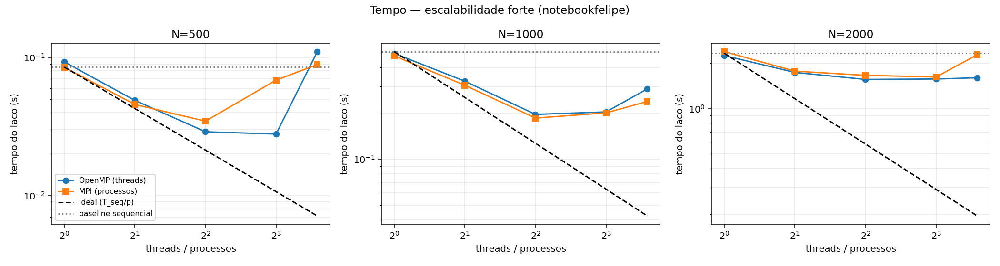
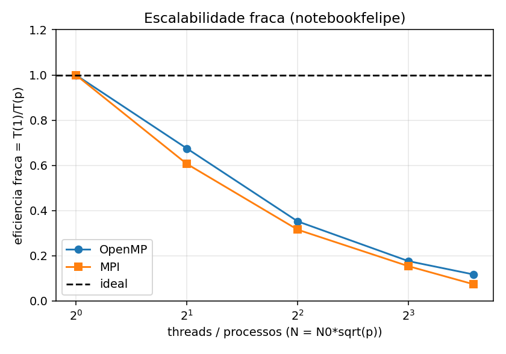
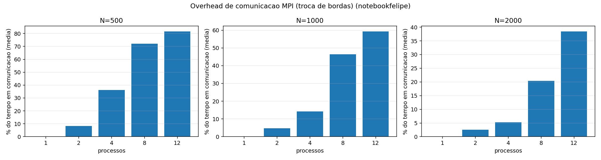
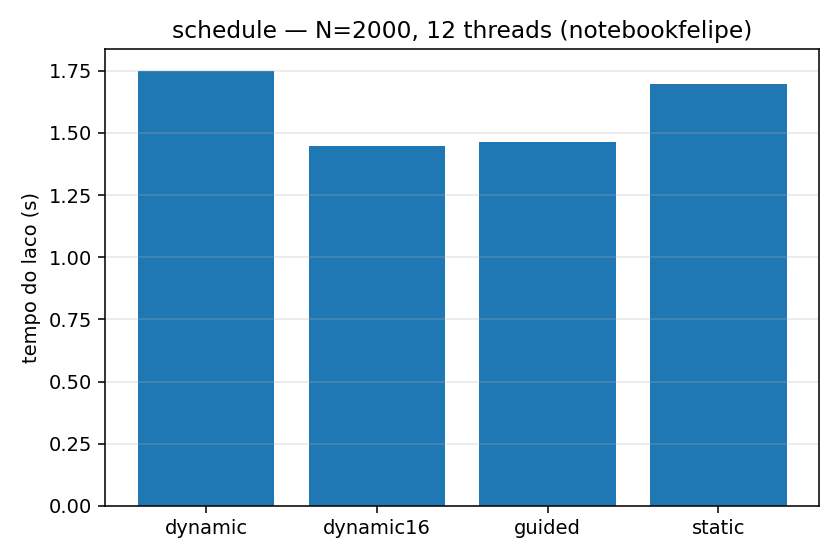
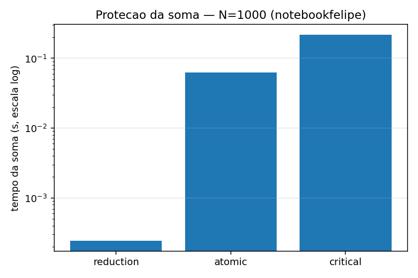

# Paralelização da Equação do Calor 2D com OpenMP e MPI

Programação Paralela (CCO085) · Centro Universitário IESB · 2026/2 · Projeto Acadêmico, Marco 2

Problema 5 --- Equação do calor 2D (stencil iterativo com troca de bordas) · Autor: Felipe Oliveira Alves/2612130043

## Resumo

Este relatório descreve a paralelização do código sequencial de referência da equação do calor 2D (stencil de Jacobi sobre uma grade N×N, durante T passos), fornecido pelo professor. Foram desenvolvidas uma versão em memória compartilhada (OpenMP) e uma em memória distribuída (MPI, com decomposição 1D por linhas e troca de bordas a cada passo). Ambas produzem a mesma grade final do baseline, bit a bit, o que foi verificado por hash em 144 comparações automáticas e em 470 execuções medidas.

As medições, feitas em um notebook com Intel Core i5-13420H, mostram speedups máximos de 3,06× (N=500, OpenMP), 2,73× (N=1000, MPI) e 1,49× (N=2000, OpenMP), muito abaixo dos limites de Amdahl (35× a 55×). A causa dominante é o limite de banda de memória: o stencil realiza apenas 4 operações de ponto flutuante para cerca de 24 bytes movidos por atualização. Observa-se ainda queda de desempenho com 12 threads, compatível com a mistura de núcleos de desempenho e de eficiência do processador combinada com escalonamento estático, e um overhead de comunicação no MPI que cresce de 3,8% a 81,4% do tempo conforme N diminui e o número de processos aumenta.

## 1. Objetivos e escopo {#objetivos-e-escopo}

O objetivo do projeto, conforme as orientações da disciplina, não é apenas escrever código paralelo, mas transformar o código sequencial fornecido em versões paralelas que produzam o mesmo resultado em menos tempo, medindo rigorosamente o ganho e explicando por que o ganho real difere do teórico. O trabalho cobre:

- baseline e perfilamento (medição do tempo de referência, identificação dos hotspots e estimativa da Lei de Amdahl);

- paralelismo em memória compartilhada (OpenMP), com tratamento explícito de condições de corrida;

- paralelismo em memória distribuída (MPI), com decomposição, troca de bordas e operações coletivas;

- análise experimental: speedup, eficiência, escalabilidade forte e fraca, e confronto com Amdahl.

Restrição do enunciado respeitada: a lógica de cálculo e a entrada do código sequencial não foram alteradas. Ele define o resultado correto.

## 2. O problema e o algoritmo sequencial {#o-problema-e-o-algoritmo-sequencial}

### 2.1 Modelo {#modelo}

A equação do calor em 2D, ∂u/∂t = α∇²u, é discretizada por diferenças finitas explícitas com o laplaciano de 5 pontos (o ponto central e seus quatro vizinhos):

u_novo(i,j) = u(i,j) + r · \[u(i−1,j) + u(i+1,j) + u(i,j−1) + u(i,j+1) − 4·u(i,j)\], com r = αΔt/Δx².

No código do professor, r = 1/4, que é o limite de estabilidade do método explícito em 2D. Com esse valor o termo do ponto central se cancela e resta u_novo = 0,25 · (soma dos 4 vizinhos), que é exatamente a iteração de Jacobi. Por isso o código lê quatro posições, embora o esquema seja chamado de stencil de 5 pontos.

### 2.2 O programa de referência {#o-programa-de-referência}

- Grade N×N de doubles, armazenada em ordem de linhas (row-major), com dois buffers (u e un) trocados a cada passo.

- Condição inicial: zero em toda a grade, exceto uma fonte de valor 100 no centro. As bordas permanecem fixas em 0 (apenas o interior é atualizado).

- Laço de tempo com T passos; em cada passo, todo o interior é recalculado a partir do buffer anterior.

- Saída: checksum (soma de todas as células) e tempo (apenas o laço de passos).

### 2.3 Complexidade e intensidade aritmética {#complexidade-e-intensidade-aritmética}

- Tempo: O(N²·T). Memória: O(N²), com 2·8·N² bytes para os dois buffers (4 MB com N=500; 16 MB com N=1000; 64 MB com N=2000).

- Cada atualização faz 4 operações de ponto flutuante (3 somas e 1 multiplicação). Estimando cerca de 24 bytes de tráfego de memória por atualização (leitura do dado novo, leitura para alocação de linha na escrita e write-back), a intensidade aritmética é de aproximadamente 0,17 operação por byte. Isso é muito baixo: o stencil tende a ser limitado pela memória, não pelo processador. Essa característica explica a maior parte dos resultados da seção 8.

### 2.4 Limitação do checksum como validador {#limitação-do-checksum-como-validador}

O esquema conserva a massa: a soma da grade permanece em torno de 100 enquanto o calor não chega à borda. Com os parâmetros padrão (500×500, 500 passos) o checksum é 100,000000 mesmo que a troca de bordas esteja errada. Por isso a validação do projeto usa também um hash da grade inteira (seção 7).

## 3. Ambiente e metodologia {#ambiente-e-metodologia}

| Item | Valor |
|----|----|
| Máquina | Notebook com Intel Core i5-13420H: 8 núcleos (4 de desempenho com 2 threads cada e 4 de eficiência), 12 threads lógicas, 12 MB de cache L3 (especificação do fabricante) |
| RAM e sistema | 32 GB DDR5 5600Mhz / Windows 11 |
| Ambiente de execução | Contêiner Docker (Ubuntu 24.04) com g++, OpenMPI e Python, definido no Dockerfile do repositório, com dev container do VS Code |
| Compilação | g++ -O2 -std=c++17 (e -fopenmp para OpenMP; mpicxx para MPI) |
| Protocolo | 1 execução de aquecimento descartada e 10 repetições por configuração; os gráficos usam a mediana |
| Tamanhos | N = 500, 1000 e 2000 com T = 500 (escalabilidade forte); N = 1000·√p (escalabilidade fraca) |
| Métricas | Speedup S(p) = T_seq / T(p), com T_seq do baseline do professor; eficiência E(p) = S(p)/p; eficiência fraca = T(1)/T(p) |
| Número de workers | 1, 2, 4, 8 e 12 (threads no OpenMP, processos no MPI) |

Todos os tempos medem apenas o laço de passos, como no código original. O script scripts/medir.sh gera os CSVs e o scripts/plotar.py produz os gráficos e tabelas.

## 4. Baseline e perfilamento {#baseline-e-perfilamento}

Foi criada uma cópia instrumentada do baseline (calor2d_ref.cpp), com a mesma lógica, que cronometra cada trecho e imprime o hash da grade final. O baseline original foi mantido intocado em sequencial/05_calor2d.cpp.

| N | Inicialização (s) | Laço do stencil (s) | Soma (s) | Fração do laço (f) | Limite de Amdahl (p→∞) |
|----|----|----|----|----|----|
| 500 | 0,0017 | 0,0626 | 0,0001 | 97,2% | 35× |
| 1000 | 0,0091 | 0,4967 | 0,0007 | 98,1% | 52× |
| 2000 | 0,0391 | 2,2541 | 0,0030 | 98,2% | 55× |

O hotspot é o laço duplo do stencil dentro do laço de tempo (97% a 98% do tempo). A inicialização e a soma final são O(N²) e desprezíveis perto de O(N²·T), mas formam a fração serial usada em Amdahl.

Previsão de Amdahl, S(p) = 1 / ((1−f) + f/p):

| N    | p=4   | p=8   |
|------|-------|-------|
| 500  | 3,69× | 6,68× |
| 1000 | 3,78× | 7,05× |
| 2000 | 3,79× | 7,09× |

Tempos de referência do baseline durante a coleta (mediana): 0,0855 s (N=500), 0,508 s (N=1000) e 2,330 s (N=2000).

## 5. Versão OpenMP {#versão-openmp}

### 5.1 Padrão e decisões de projeto {#padrão-e-decisões-de-projeto}

- **Padrão:** laço paralelo (omp for) sobre as linhas da grade. Cada thread recebe um bloco de linhas, e o laço interno percorre as colunas na ordem de memória.

- **Região paralela única:** a região parallel envolve todo o laço de tempo, em vez de criar e destruir threads a cada passo (um único fork/join). Cada thread mantém ponteiros privados cur e nxt e os troca localmente a cada passo, o que evita uma seção single e uma sincronização extra.

- **Escalonamento:** schedule(runtime), de modo que a política (static, dynamic, guided) é escolhida pela variável OMP_SCHEDULE sem recompilar. Isso permitiu o estudo da seção 8.4.

- **First-touch:** a grade é inicializada em paralelo com schedule(static), para que as páginas de memória fiquem próximas das threads que as usarão (relevante em máquinas NUMA).

### 5.2 Condições de corrida {#condições-de-corrida}

- **Stencil: não há corrida.** Cada passo lê somente cur e escreve somente nxt (dois buffers), e cada thread escreve em linhas distintas. A barreira implícita ao final do omp for garante que o passo t termine antes do passo t+1.

- **Soma do checksum: corrida potencial**, porque todas as threads acumulariam na mesma variável soma. Foram implementadas quatro variantes, selecionáveis na compilação:

  - reduction(+:soma) (padrão): cada thread soma em uma variável privada e as parciais são combinadas no final;

  - atomic: cada acréscimo é uma operação atômica;

  - critical: cada acréscimo fica em uma seção crítica;

  - sem proteção (calor2d_omp_race): existe apenas para demonstrar a corrida de dados (o checksum pode variar entre execuções).

- **Escolha justificada:** reduction, pelo custo medido na seção 8.5.

- **False sharing:** não é relevante, pois as threads escrevem em linhas distintas e só as linhas de fronteira entre blocos compartilham linhas de cache.

## 6. Versão MPI {#versão-mpi}

### 6.1 Decomposição de domínio {#decomposição-de-domínio}

Decomposição 1D por faixas de linhas (row-block). As N linhas são divididas em P blocos contíguos; os primeiros N mod P processos recebem uma linha a mais, o que trata N não divisível por P. Cada processo armazena suas linhas mais duas linhas fantasma (halo): a de cima e a de baixo, cópias das linhas de borda dos vizinhos. Como a grade é row-major, cada linha de halo é um bloco contíguo de N doubles, sem necessidade de tipos derivados do MPI.

Justificativa: a decomposição 1D é a mais simples que respeita a estrutura do stencil e mantém o código curto e verificável. A decomposição 2D reduziria o volume comunicado por processo, mas exigiria tipos derivados para as colunas.

### 6.2 Troca de bordas (halo exchange) {#troca-de-bordas-halo-exchange}

A cada passo, antes de calcular, cada processo executa duas chamadas MPI_Sendrecv:

1.  envia sua primeira linha ao vizinho de cima e recebe a linha fantasma de baixo;

2.  envia sua última linha ao vizinho de baixo e recebe a linha fantasma de cima.

MPI_Sendrecv evita deadlock sem depender de ordem de envio e recepção. Nas pontas usa-se MPI_PROC_NULL, que transforma a operação em no-op. As linhas globais 0 e N−1 permanecem fixas em 0, como no baseline, e o processo dono da linha N/2 inicializa a fonte quente.

### 6.3 Operações coletivas {#operações-coletivas}

- MPI_Bcast: distribui os parâmetros (N e T) a partir do processo 0.

- MPI_Reduce com MPI_SUM: soma as somas parciais para o checksum.

- MPI_Reduce com MPI_MAX e MPI_SUM: tempo do programa (processo mais lento) e tempo de comunicação (máximo e média).

- MPI_Gatherv: reúne a grade final no processo 0 para calcular o hash de validação. Esse passo fica fora da região cronometrada.

### 6.4 Modelo de custo {#modelo-de-custo}

Por passo e por processo, o cálculo é proporcional a (N/P)·N e a comunicação é de 2N doubles, constante em P. Portanto, com N fixo, a razão comunicação/cálculo cresce linearmente com P. Isso explica por que a eficiência do MPI cai com mais processos, e mais rapidamente quanto menor o N.

## 7. Validação de corretude {#validação-de-corretude}

Todas as versões imprimem, além do checksum e do tempo, um hash FNV-1a de 64 bits calculado sobre os bytes da grade final em ordem de linhas. Hashes iguais significam grades idênticas bit a bit. Isso é possível porque a atualização de cada célula não depende da ordem de execução; apenas a soma do checksum muda de ordem em reduction e MPI_Reduce, o que gera diferenças da ordem de 1e-13 e por isso é comparada com tolerância relativa de 1e-9.

O script scripts/validar.sh executa 144 comparações contra o baseline instrumentado:

- 6 casos de entrada, incluindo N pequeno (16), N ímpar (101), N=257 e um caso (N=64 com 3000 passos) em que o calor chega à borda e o checksum deixa de ser quase constante;

- OpenMP com 1, 2, 3, 4 e 8 threads, com os três escalonamentos, mais as variantes atomic e critical;

- MPI com 1, 2, 3, 4, 5 e 7 processos, incluindo casos em que N não é divisível pelo número de processos;

- verificação de que a cópia instrumentada produz o mesmo checksum do código original do professor.

Resultado: todas as comparações passaram. Nas medições, as 470 execuções de OpenMP e MPI produziram um único hash para cada par (N, T), isto é, o resultado não muda com o número de threads ou de processos.

## 8. Resultados experimentais {#resultados-experimentais}

As figuras abaixo foram geradas pelo script `scripts/plotar.py` a partir dos CSVs de `dados/`; os arquivos estão em `graficos/` (notebookfelipe\_\*.png).

### 8.1 Escalabilidade forte {#escalabilidade-forte}

Speedup (mediana de 10 repetições):

| N    | Versão | p=2  | p=4  | p=8  | p=12 |
|------|--------|------|------|------|------|
| 500  | OpenMP | 1,75 | 2,95 | 3,06 | 0,77 |
| 500  | MPI    | 1,87 | 2,47 | 1,25 | 0,96 |
| 1000 | OpenMP | 1,56 | 2,58 | 2,49 | 1,76 |
| 1000 | MPI    | 1,66 | 2,73 | 2,52 | 2,13 |
| 2000 | OpenMP | 1,34 | 1,49 | 1,48 | 1,45 |
| 2000 | MPI    | 1,31 | 1,40 | 1,44 | 1,02 |

*Figura 1 — Speedup da escalabilidade forte (OpenMP e MPI), com a curva ideal e a previsão de Amdahl*

Eficiência (S/p):

| N    | Versão | p=2  | p=4  | p=8  | p=12 |
|------|--------|------|------|------|------|
| 500  | OpenMP | 0,87 | 0,74 | 0,38 | 0,06 |
| 500  | MPI    | 0,93 | 0,62 | 0,16 | 0,08 |
| 1000 | OpenMP | 0,78 | 0,65 | 0,31 | 0,15 |
| 1000 | MPI    | 0,83 | 0,68 | 0,32 | 0,18 |
| 2000 | OpenMP | 0,67 | 0,37 | 0,19 | 0,12 |
| 2000 | MPI    | 0,66 | 0,35 | 0,18 | 0,09 |

*Figura 2 — Eficiência (S/p) da escalabilidade forte*

Com 1 thread ou 1 processo, os speedups ficam entre 0,92 e 1,07, ou seja, o custo da versão paralela com p=1 é desprezível frente ao ruído de medição.

*Figura 3 — Tempo do laço em função do número de threads ou processos, por tamanho de grade*

### 8.2 Escalabilidade fraca {#escalabilidade-fraca}

Com N² / p constante (N = 1000, 1414, 2000, 2828 e 3464 para p = 1, 2, 4, 8 e 12), a eficiência T(1)/T(p) foi:

| p      | 2    | 4    | 8    | 12   |
|--------|------|------|------|------|
| OpenMP | 0,68 | 0,35 | 0,18 | 0,12 |
| MPI    | 0,61 | 0,32 | 0,15 | 0,07 |

O tempo cresce quase linearmente com p, que é o comportamento esperado de um programa limitado por banda: o volume total de dados cresce com p, mas a banda da memória é fixa. Ressalva: o caso p=1 (N=1000) tem dados que quase cabem no cache, enquanto os maiores não; parte da queda é, portanto, efeito de capacidade de cache.

*Figura 4 — Eficiência da escalabilidade fraca, T(1)/T(p)*

### 8.3 Overhead de comunicação (MPI) {#overhead-de-comunicação-mpi}

Fração do tempo do laço gasta na troca de bordas (média entre processos):

| N    | p=2   | p=4   | p=8   | p=12  |
|------|-------|-------|-------|-------|
| 500  | 10,5% | 26,0% | 67,0% | 81,4% |
| 1000 | 6,0%  | 14,5% | 42,1% | 56,4% |
| 2000 | 3,8%  | 6,1%  | 23,3% | 56,5% |

O comportamento confirma o modelo da seção 6.4. Esse tempo inclui a espera pelo vizinho mais lento, e não apenas a cópia dos dados, pois a troca de bordas também sincroniza os processos a cada passo.

*Figura 5 — Fração do tempo gasta em comunicação no MPI (troca de bordas)*

### 8.4 Políticas de escalonamento (OpenMP, N=2000, 12 threads) {#políticas-de-escalonamento-openmp-n2000-12-threads}

| Política                   | Mediana (s) |
|----------------------------|-------------|
| static                     | 1,70        |
| dynamic (chunk de 1 linha) | 1,75        |
| dynamic,16                 | 1,45        |
| guided                     | 1,46        |

A carga por linha é uniforme, portanto não há desbalanceamento de trabalho. Mesmo assim, dynamic,16 e guided ficaram cerca de 15% abaixo de static com 12 threads, o que é compatível com desbalanceamento de velocidade entre os tipos de núcleo (seção 9). O dynamic com chunk de 1 linha não ganha, porque paga o custo de distribuir cada linha. As faixas de mínimo e máximo se sobrepõem parcialmente, então o resultado é indicativo, não conclusivo. Em uma primeira rodada de medições com 5 repetições as diferenças ficaram dentro do ruído, o que reforça essa cautela.

*Figura 6 — Tempo do laço por política de escalonamento (N=2000, 12 threads)*

### 8.5 Proteção da soma (N=1000, 12 threads) {#proteção-da-soma-n1000-12-threads}

| Proteção  | Tempo da soma (s) | Relativo      |
|-----------|-------------------|---------------|
| reduction | 0,00024           | 1×            |
| atomic    | 0,063             | cerca de 260× |
| critical  | 0,216             | cerca de 900× |

atomic e critical serializam as 10⁶ somas; reduction acumula parciais privadas e combina uma vez. Foi a escolha adotada.

*Figura 7 — Tempo da soma com reduction, atomic e critical (escala logarítmica)*

## 9. Discussão: por que o ganho real difere do teórico {#discussão-por-que-o-ganho-real-difere-do-teórico}

O ganho medido fica muito abaixo da previsão de Amdahl: por exemplo, 2,6× contra 3,8× com 4 threads em N=1000, e 1,5× contra 7,1× com 8 threads em N=2000. A fração serial (cerca de 2%) explica apenas uma parte pequena dessa diferença. As causas observadas, em ordem de importância:

1.  **Limite de banda de memória (causa principal).** Com N=500 os buffers ocupam 4 MB e cabem no L3 (12 MB); com N=1000 ocupam 16 MB, no limite do L3; com N=2000 ocupam 64 MB e o laço é servido pela RAM. O speedup cai exatamente nessa ordem (cerca de 3,0×, 2,5× a 2,7× e 1,4× a 1,5×). Com cerca de 24 bytes por atualização, o baseline de N=2000 move aproximadamente 48 GB em 2,33 s, ou seja, cerca de 21 GB/s com uma única thread; o OpenMP com 4 a 8 threads chega a cerca de 31 GB/s e deixa de melhorar. A memória é o recurso compartilhado que satura. Os 24 bytes por atualização são uma estimativa; uma medição de banda com um benchmark do tipo STREAM confirmaria o valor.

2.  **Queda com 12 threads.** O processador é híbrido: as 8 threads dos núcleos de desempenho (com SMT) são mais rápidas que as 4 dos núcleos de eficiência. Com schedule(static) cada thread recebe o mesmo número de linhas e há uma barreira a cada passo, de modo que cada passo dura o tempo da thread mais lenta. Esta é uma hipótese consistente com a seção 8.4, mas não foi testada diretamente (por exemplo, fixando threads por tipo de núcleo). No MPI, o mesmo efeito ocorre porque a troca de bordas sincroniza os processos.

3.  **Overhead de comunicação e sincronização.** No MPI, a fração de comunicação chega a 81% (seção 8.3). Em N=500 cada passo dura cerca de 0,1 ms, e o custo da barreira (OpenMP) ou da troca de bordas (MPI) deixa de ser desprezível, o que faz N=500 saturar já em p=4.

4.  **Fração serial.** Inicialização e soma (2% a 3%) limitam o speedup máximo teórico, mas não são o fator limitante nas faixas de p medidas.

5.  **False sharing:** não é relevante neste problema, como explicado na seção 5.2.

## 10. Limitações e ameaças à validade {#limitações-e-ameaças-à-validade}

- **Deriva do sistema entre medições.** O baseline medido durante a coleta (N=500: 0,086 s) ficou mais lento do que o do perfilamento feito antes (0,063 s). Notebooks mudam de frequência com temperatura e energia, o que desloca todos os speedups. Os valores absolutos devem ser lidos como indicativos; as conclusões qualitativas (limite de banda, saturação entre 4 e 8 workers, queda com 12) se repetiram em duas rodadas de medição.

- **Ambiente virtualizado.** As medições foram feitas em Docker sobre WSL2, que pode ocultar parte da topologia híbrida de núcleos.

- **Ruído com 12 threads.** É onde a variação entre repetições é maior.

- **Máquina única.** Os resultados refletem um notebook; a banda de memória e a topologia de núcleos do computador do laboratório podem mudar as curvas.

- **Estimativas não verificadas diretamente:** os 24 bytes por atualização e a hipótese dos núcleos heterogêneos.

## 11. Conclusões {#conclusões}

- As duas versões paralelas reproduzem exatamente o resultado do baseline, para qualquer número de threads ou processos testado.

- O speedup observado é modesto (no máximo cerca de 3×) e depende fortemente do tamanho do problema: quanto maior o N, mais o desempenho é determinado pela banda de memória e não pelo número de núcleos.

- A Lei de Amdahl, com a fração serial medida no perfilamento, prevê limites muito superiores aos observados. O modelo que explica os dados é o de um programa limitado pela memória, com sobrecustos de sincronização e de comunicação quando o trabalho por passo é pequeno.

- No OpenMP, reduction é a proteção adequada para a soma, e static é uma boa escolha geral; dynamic,16 ou guided mostraram ganho apenas com 12 threads, em processador híbrido.

- No MPI, a decomposição 1D é simples e correta, mas o volume de comunicação por processo é constante, o que limita a escalabilidade para N pequeno. Trabalhos futuros: decomposição 2D, sobreposição de comunicação e cálculo (MPI_Isend e MPI_Irecv), blocagem de cache no tempo e uma versão híbrida MPI+OpenMP.

## 12. Reprodutibilidade {#reprodutibilidade}

### 12.1 Estrutura do repositório {#estrutura-do-repositório}

- sequencial/05_calor2d.cpp: baseline do professor, intocado;

- sequencial/calor2d_ref.cpp: cópia instrumentada (cronômetro por trecho e hash);

- openmp/calor2d_omp.cpp: versão OpenMP, com variantes de soma;

- mpi/calor2d_mpi.cpp: versão MPI;

- comum/util.h: cronômetro e hash;

- scripts/: validar.sh, perfil.sh, medir.sh, plotar.py;

- dados/ e graficos/: CSVs e figuras; ANALISE.md, README.md e AUTORES.md.

### 12.2 Como executar {#como-executar}

docker build -t calor2d .\
docker run -it \--rm -v \$PWD:/workspace calor2d\
make \# compila tudo em bin/\
make test \# valida OpenMP e MPI contra o baseline\
MAQUINA=nome make perfil\
MAQUINA=nome make medir\
make graficos

As variáveis REPS, T, SIZES e NCORES controlam o protocolo de medição. O ambiente de referência da disciplina é Linux com g++ e OpenMPI; o contêiner reproduz esse ambiente em qualquer computador.
